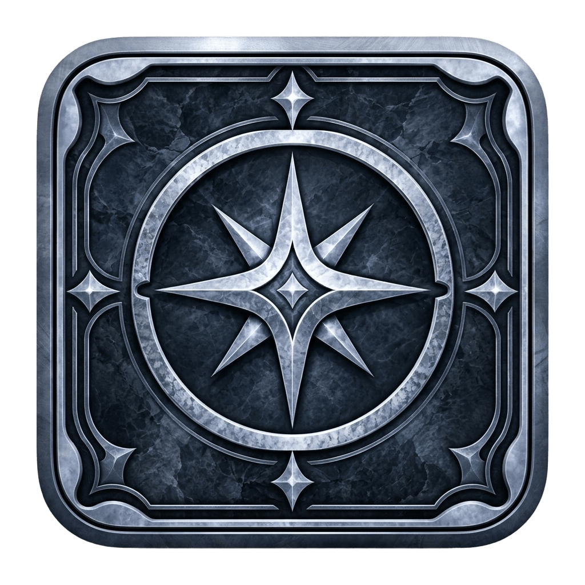
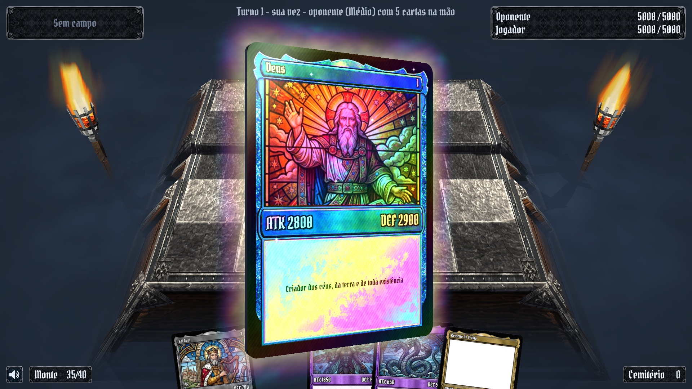

<p align="center"></p>

# PONTIFICE



PONTIFICE é um jogo eletrônico brasileiro de cartas lançado exclusivamente para computadores inspirado na temática biblica.

## Configurações

O projeto usa **C++20**, **CMake**, **Ninja** e **SDL3**, mais as bibliotecas header-only **cgltf** (modelos glTF) e **stb_image** (PNG). Todas são baixadas automaticamente pelo CMake na primeira build, então não precisa instalar nada além do toolchain.

### 1. Pré-requisitos

**macOS**

```bash
xcode-select --install          # compilador clang e SDK
brew install cmake ninja
```

**Linux (Debian/Ubuntu)**

```bash
sudo apt install build-essential cmake ninja-build git \
  libx11-dev libxext-dev libwayland-dev libxkbcommon-dev libegl1-mesa-dev \
  libasound2-dev libpulse-dev libdbus-1-dev libudev-dev
```

**Windows**

Instale Visual Studio 2022 (workload "Desktop development with C++"), CMake e Ninja. Rode os comandos no "Developer PowerShell for VS".

### 2. Clonar

```bash
git clone <url-do-repositorio> PONTIFICE
cd PONTIFICE
```

### 3. Compilar

```bash
./build.sh            # Debug (padrão)
./build.sh Release    # otimizado
```

O script roda `cmake -S . -B build -G Ninja` e depois `cmake --build build`. Na primeira vez o CMake baixa o SDL3 (tag `release-3.4.18`) para `build/_deps/` e compila como biblioteca estática. Leva alguns minutos. Nas próximas builds só o código do jogo é recompilado.

Só a primeira build precisa de internet. Depois disso `./build.sh` e `./run.sh` funcionam offline: as dependências em `build/_deps/` não são atualizadas na reconfiguração (`FETCHCONTENT_UPDATES_DISCONNECTED`). Para baixar versões novas, apague `build/`.

O binário fica em `build/pontifice`, com `assets/` e `sprites/` copiados para o lado dele.

### 4. Executar

```bash
./run.sh              # compila e abre o jogo
./build/pontifice     # só abre, sem recompilar
```

O jogo abre na escolha de idioma (`docs/idioma.md`: inglês, espanhol ou português) e segue para o menu (`docs/menu.md`). `Esc` sai. "Jogar" abre a batalha com a mão de cartas em 3D.

**Linux (Vulkan)**: os shaders precisam ser compilados para SPIR-V. Instale `glslc` (pacote `shaderc` ou Vulkan SDK) antes de rodar `./build.sh`; o CMake detecta e compila sozinho. No macOS (Metal) não é necessário.

### 5. Usar um SDL3 já instalado (opcional)

Se o SDL3 estiver instalado no sistema, o CMake usa ele e pula o download:

```bash
brew install sdl3                 # macOS
sudo apt install libsdl3-dev      # Linux, quando disponível na distro
```

Para forçar o download mesmo com SDL3 instalado, apague `build/` e configure com `-DCMAKE_DISABLE_FIND_PACKAGE_SDL3=ON`.

### 6. Como o SDL3 está ligado ao projeto

Trecho relevante do `CMakeLists.txt`:

```cmake
find_package(SDL3 CONFIG QUIET)
if(NOT SDL3_FOUND)
  include(FetchContent)
  set(SDL_SHARED OFF CACHE BOOL "" FORCE)
  set(SDL_STATIC ON CACHE BOOL "" FORCE)
  FetchContent_Declare(SDL3
    GIT_REPOSITORY https://github.com/libsdl-org/SDL.git
    GIT_TAG release-3.4.18
    GIT_SHALLOW TRUE)
  FetchContent_MakeAvailable(SDL3)
endif()

target_link_libraries(pontifice PRIVATE SDL3::SDL3)
```

No código, inclua `#include <SDL3/SDL.h>`. O `main.cpp` cria a janela, um renderer 2D sobre o SDL_GPU (`SDL_CreateGPURenderer`) e roda o loop de cenas. O 3D usa o mesmo device via `SDL_GetGPURendererDevice`. Para atualizar o SDL3, troque a tag em `GIT_TAG` e apague `build/`.

cgltf e stb são declarados da mesma forma logo abaixo, com `SOURCE_SUBDIR cmake-none` para só expor os headers.

### 7. Problemas comuns

**`fatal error: 'cstdio' file not found` no macOS**

Alguns Command Line Tools deixam um diretório antigo e incompleto em `/Library/Developer/CommandLineTools/usr/include/c++/v1`, que esconde o libc++ do SDK. O `CMakeLists.txt` detecta isso e aponta o compilador para o libc++ do SDK. Para corrigir de vez na máquina:

```bash
sudo mv /Library/Developer/CommandLineTools/usr/include/c++ \
        /Library/Developer/CommandLineTools/usr/include/c++.bak
```

**Build antiga quebrada**

Apague `build/` e rode `./build.sh` de novo.

## Documentação

- [Regras do jogo](docs/regraJogo.md): objetivo, componentes, fluxo da partida, fim da batalha e regras gerais.
- [Cartas](docs/cartas.md): categorias, hierarquias e cartas de campo.
- [Campo](docs/campo.md): slots, layout 5x2 e regras de posicionamento.
- [Batalha](docs/batalha.md): fases do turno, invocação, posições, ataque e cálculo de dano.
- [HUD](docs/hud.md): carta de campo ativa e pontos de vida na tela.
- [Idioma](docs/idioma.md): primeira cena, escolha entre inglês, espanhol e português; textos em `assets/translate.json`.
- [Menu](docs/menu.md): botões Jogar, Nível e Sair.
- [Detalhes técnicos](docs/detalhesTecnicos.md): stack, estrutura do projeto, formato das cartas e renderização 3D.
